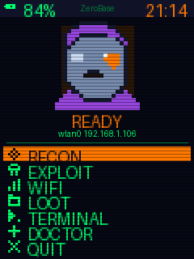

# AYBABTU

A pwnagotchi-style **pixel-art** launcher for a handheld Kali rig (Pi Zero 2W +
BlackBerry keyboard + small colour TFT), styled after the *Zero Wing / CATS*
intro. It renders a **portrait** graphical UI straight to the framebuffer — a
cyber-villain mascot with a glowing cybernetic eye, an icon menu, a battery
glyph and CRT scanlines — and wraps the Kali tools behind big buttons.



The mascot's cyber eye changes with its mood: orange when idle (READY), yellow
with a scan-sweep while scanning, red when there are exploits to hunt.

## Controls
up/down or `j`/`k` move · number keys jump · `Enter`/`→` select · `q` quit

## What the buttons do
- **RECON** — pick a target (scope-confirmed), choose an nmap profile, scan.
  Output auto-saves to `loot/`, then AYBABTU parses the open services and
  offers **one-tap exploit leads** (searchsploit / msfconsole). Recon flows
  straight into exploit.
- **EXPLOIT** — searchsploit lookup or drop into msfconsole.
- **WIFI** — interfaces + nearby APs.
- **LOOT** — browse saved scans.
- **TERMINAL** — real shell, returns to the UI on exit.
- **DOCTOR** — self-check: framebuffer, battery, i2c, wifi, installed tools —
  with fix-it hints.
- Plus your own buttons via `menu.json`.

## How it works
Graphical output is composited with Pillow (`gfx.py`) and blitted to `/dev/fb0`
(`display.py`), which auto-detects the panel's size and bit-depth (32/16/8/1
bpp — the mono Sharp LCD is 1-bit). The keyboard is read in raw mode; the UI
only drops to the text console while a tool actually runs.

| file          | role                                               |
|---------------|----------------------------------------------------|
| `aybabtu.py`  | graphical main loop (framebuffer UI)               |
| `gfx.py`      | portrait pixel-art compositor (mascot, icons, menu) |
| `display.py`  | framebuffer blitter (bpp autodetect) + key input   |
| `actions.py`  | the button flows (recon→exploit chaining, etc.)    |
| `campaign.py` | nmap parser → searchsploit lead suggester          |
| `hw.py`       | battery gauge + `doctor()` hardware self-check      |
| `faces.py`    | mascot moods + All-Your-Base taunts                |
| `aybabtu_tui.py` | pure-text curses fallback (no graphics)         |
| `menu.json`   | your custom buttons (no coding)                    |

## Install on the Pi
```bash
git clone https://github.com/aidan-mitchell-645/aybabtu.git
cd aybabtu && ./install.sh          # installs Pillow, adds you to 'video' grp
python3 ~/aybabtu/aybabtu.py        # run on the console (tty1)
```
### Start on boot (pwnagotchi-style)
```bash
sudo ./enable-boot.sh        # installs a systemd service that owns tty1
# undo: sudo ./enable-boot.sh --disable
```
This makes AYBABTU launch at boot and take over the Pi's screen, with
"drop to terminal" and tool output still working on-device. SSH keeps working
independently so you can always manage it (`sudo systemctl stop aybabtu`).

### Preview without hardware (over SSH / laptop)
```bash
AYBABTU_SIM=/tmp/aybabtu python3 aybabtu.py   # writes PNG frames instead
```

## Display tuning
| env | effect |
|-----|--------|
| `AYBABTU_ROTATE=90` | rotate the UI 0/90/180/270 if orientation is wrong |
| `AYBABTU_INVERT=1` | flip black/white (some mono panels are inverted) |
| `AYBABTU_FB=/dev/fb1` | use a specific framebuffer |
| `AYBABTU_NOSCAN=1` | turn off CRT scanlines |
`python3 display.py` prints the detected framebuffer geometry/bpp. The UI is
composed in portrait and auto-rotated onto landscape framebuffers; use
`AYBABTU_ROTATE` to correct the direction if it comes out sideways/upside-down.

## Battery gauge (one-time)
If `DOCTOR` says the gauge is missing, install the Beepy keyboard driver — it
publishes `/sys/firmware/beepy/battery_percent`, which AYBABTU reads
automatically:
```bash
git clone https://github.com/ardangelo/beepy-kbd
cd beepy-kbd && make && sudo make install && sudo reboot
```

## Adding your own buttons
Edit `menu.json`. `{t}`/`{target}` is replaced with the target you type; set
`"needs_scope": true` to force the authorized-target confirm first.
```json
{ "key": "8", "label": "NIKTO", "desc": "web scan", "needs_scope": true,
  "cmd": "nikto -h {t}" }
```

## Scope / ethics
Recon makes you type `YES` to confirm the target is yours or you're authorized
to test it. Only scan and exploit what you own or have written permission to touch.

## Roadmap
- Framebuffer-native idle animation (mascot blinking as a screensaver)
- Signal-strength driven mood · per-host loot notes · campaign history
